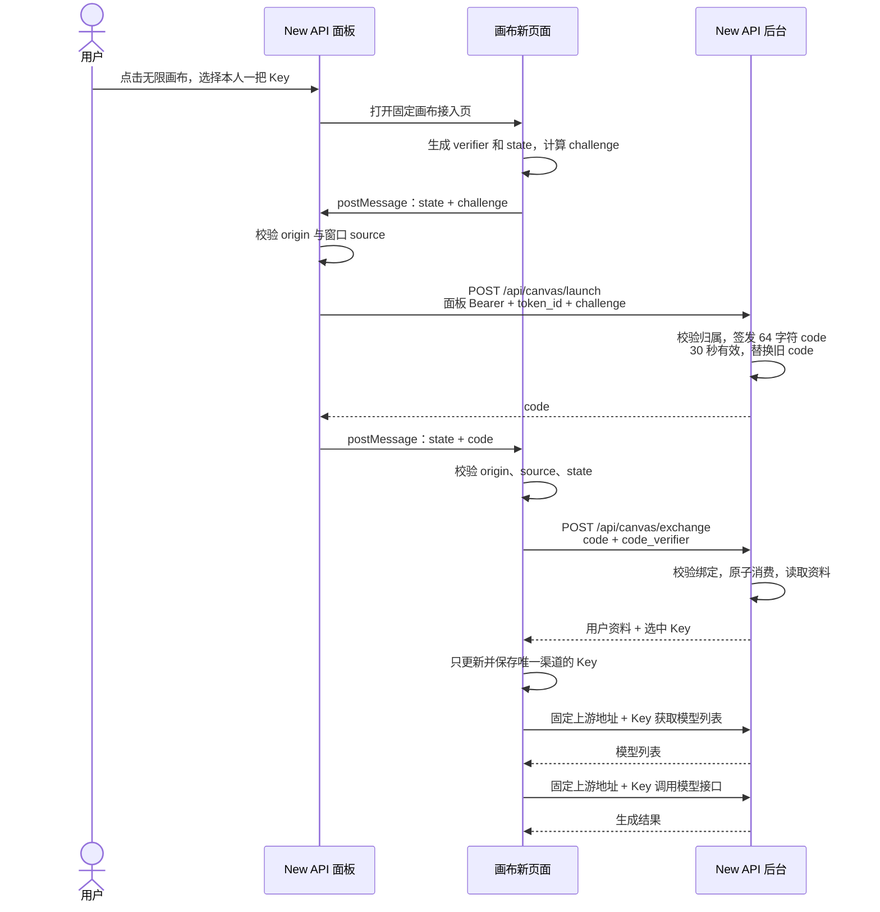
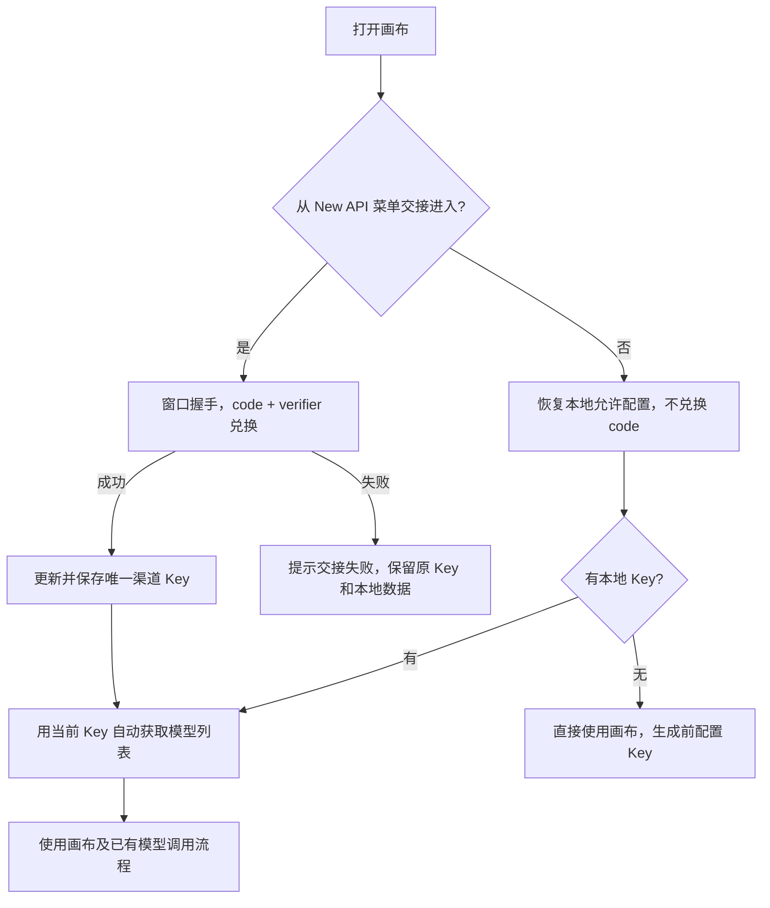

# New API 与无限画布接入设计

状态：双方代码已实现，专项自动测试已通过，真实部署联调待人工确认。实际部署和验证说明见 [upstream-integration-deployment.md](./upstream-integration-deployment.md)，恢复记录见 [upstream-integration.todo.md](./upstream-integration.todo.md)。本文保留已认可的业务设计，接口和配置名已落实。

## 1. 目标与已确认范围

用户在自己控制的 New API 面板中点击“无限画布”，选择本人一个模型 API Key，新页面自动完成 Key 交接。New API 负责认证和 Key 归属校验，画布只使用取得的 Key，配合部署固定的 New API 地址调用原有模型接口。直接打开画布也可以使用，不要求先从菜单进入。

- 画布使用独立域名，不部署到 New API 子路径。
- 不登记 OAuth client，不使用 client_id、client_secret，也不新增画布专用模型访问令牌。
- 画布保持浏览器前端直连 New API 的架构，本方案不要求增加画布业务后端。
- 全站只有一个有效上游渠道，base URL 由部署配置固定。
- 用户不能新增、删除渠道，不能编辑渠道地址；渠道基础配置仅允许修改 Key，名称、协议等不作为用户可编辑入口。
- 模型配置等其他已有用户设置尽量保留，不重做生成服务。
- New API 展示当前登录用户本人的 Key 列表，单选一个后进入画布，只交付选中的一把完整 Key。
- Key 的保存行为沿用画布现状。当前画布会在浏览器本地保存渠道 Key；配置导出目前也会带 Key。本轮要求去掉的是渠道地址，不另外改变 Key 保存/导出策略。
- 不新增用户注册或授权确认步骤；用户操作是点击菜单、选择一把 Key 并进入。
- 不显示用户资料，不增加账号、余额或分组展示及持续刷新功能。为少改画布，建议不接入用户身份 store；此前兑换响应中的用户快照可保留，但画布只消费 Key。
- 无论浏览器本地是否有 Key，都允许直接访问画布；直接访问不执行 code 兑换。有 Key 时可按原流程调用模型，没有 Key 时仍可使用画布，生成需要先配置 Key。
- 手动修改 Key 后，后续模型请求使用当前 Key，New API 按该 Key 识别用户及权限；画布不维护额外登录身份，也无需同步用户资料。
- 切换账号或 Key 时，本地项目、素材不隔离，不清空，不新增账号命名空间。
- 首次进入时，有 Key 才自动获取模型列表；直接访问使用本地 Key，从菜单进入则等成功交接取得 Key 后获取。
- 上游固定由用户自己运营，不考虑更换上游，不增加旧 Key 来源绑定或跨上游迁移处理。

源码已确认：当前画布支持多渠道，但每个渠道只有一个 `apiKey`。此次固定为单渠道，复用已有 channels 结构及调用流程，无须增加多 Key 列表、全选、轮换或负载均衡。

## 2. 部署配置与信任关系

示例：

| 项目 | 部署配置 |
| --- | --- |
| New API 公开地址 | `https://api.example.com` |
| 画布公开地址 | `https://canvas.example.com` |
| 画布部署配置 | `NEW_API_BASE_URL=https://api.example.com` |
| New API 部署配置 | `CANVAS_BASE_URL=https://canvas.example.com` |

画布沿用现有运行期 `config.js` 注入方式读取公开上游地址。部署配置不包含管理员密钥、统一用户 Key 或 client secret。

New API 服务端读取部署环境变量 `CANVAS_BASE_URL` 的固定画布 origin，由状态接口提供菜单目标，不需要另建 OAuth 应用登记。请求参数不得自行指定可信接收方或任意重定向地址。

所有窗口消息和跨域接口规则都使用这两个固定 origin。CORS 只允许画布的准确 origin；CORS 本身不充当用户认证或 code 持有者证明。

本稿针对用户要求的固定上游部署，不擅自扩展为“固定模式与原多渠道模式并存”的双模式实现。

## 3. 渠道与用户配置规则

核心规则：**渠道地址不属于用户配置；所有正常配置入口和请求解析都以部署地址为唯一来源。**

| 入口 | 当前设计 |
| --- | --- |
| 渠道配置界面 | 仅一个渠道；去掉新增、删除、修改地址的入口，基础配置只允许改 Key |
| New API 交接 | 更新唯一渠道的 Key，不新增渠道；返回数据不用于改地址 |
| 旧 URL 参数导入 | 移除 `baseUrl/baseurl`、`apiKey/apikey` 凭据导入入口 |
| 配置文件导出 | 不写出顶层或渠道内的 base URL；其他允许配置沿用现有行为 |
| 配置文件导入 | 按允许字段读取，不接受地址或任意渠道列表；外部文件即使夹带地址，也不能生效 |
| 浏览器本地保存 | 不保存渠道地址；Key、模型等用户设置按现有机制保存 |
| 浏览器本地恢复 | 只恢复允许字段，地址从当前部署配置取得；不能整包覆盖运行时配置 |
| 生成请求解析 | 始终取部署固定地址和唯一渠道当前 Key |

可以为减少生成服务改动，在运行时对象中补齐现有代码需要的 `baseUrl` 字段；该字段只由部署配置生成，不属于导入、导出或持久化数据。

现有配置文件包含其他配置，如 WebDAV、提示词源等；本次“禁止渠道地址”不自动等于删除这些独立功能的地址。仅删除旧凭据导入参数，不笼统禁止所有路由或业务 URL 参数。

项目尚未上线，不要求迁移旧多渠道数据，不编写旧字段兼容或数据迁移兜底。部署上游始终为用户自己的 New API；配置导入中的允许字段按当前固定上游规则处理，不增加 Key 来源元数据或上游更换方案。

## 4. 一次性 code 的确定规则

| 项目 | 规则 |
| --- | --- |
| 长度 | 64 个字符 |
| 字符集 | `A-Z`、`a-z`、`0-9` |
| 生成方式 | 密码学安全随机数，不使用普通伪随机 |
| 有效期 | 从服务端成功签发开始计算 30 秒 |
| 同时有效数量 | 同一用户最多一个有效 code，新 code 使旧 code 失效 |
| 使用次数 | 只能成功兑换一次 |
| 归属 | 绑定真实登录用户及所选 token ID，不能相信客户端传入的 user ID |
| 建议附加绑定 | 页面 challenge、来源会话、固定目标 origin |
| 缓存内容 | code 摘要和交接元数据；不缓存所有完整 Key |
| 并发保证 | 签发替换、兑换校验及消费需保证原子语义，不能简单先读取再删除 |
| 缓存实现 | 沿用 New API 已有 Redis / 内存缓存架构；单实例内存实现需加锁保证原子语义，多实例共用 Redis；共享缓存故障时不能静默退回各实例独立内存 |

一个用户从多个页面连续进入时，只有最后签发的未消费 code 有效。已经交接成功的页面不因后来签发新 code 而自动失去模型 Key。

30 秒只约束交接凭据。交付后的模型 Key 继续按其状态、有效期、额度、模型、分组和 IP 等限制执行；New API 面板退出不会天然撤销这把模型 Key。

## 5. 已认可的技术流程：新页面持有秘密，code 绑定该页面

为了实现前面讨论的“绑定发起页面”，使用原 New API 页面与新画布页面的窗口握手。用户已理解并认可此流程：用户身份由 New API 原页面携带的面板登录凭据确定；verifier / challenge 用于证明兑换者持有新页面生成的秘密。

定义：N 为原 New API 已登录页面，C 为新打开的画布接入页，S 为 New API 后台。

1. 用户在 N 选择本人一把 Key，点击进入时同步打开固定的 C，并保存新窗口引用；N 先注册握手监听。
2. C 生成随机 `verifier` 和 `state`，只保存在本页面内存。计算 `code_challenge = BASE64URL(SHA256(verifier))`。
3. C 用定向 `postMessage` 把 `state`、`code_challenge` 和方法 `S256` 交给 N，不传 verifier。
4. N 校验消息的精确 origin、窗口 source 和结构，只接受本次打开窗口的首个有效握手，然后携带自身已有面板 Bearer 调用签发接口，提交选中的 token ID 与 challenge。
5. S 从登录会话取得真实用户，确认 token 属于本人且可用，生成并缓存 code，30 秒有效；替换该用户此前未使用的 code。
6. N 通过保存的新窗口引用定向发送 code 和原 state 给 C。C 核对精确 New API origin、opener/source 和本次 state。
7. C 向部署固定的 New API 兑换接口提交 code 与 verifier。
8. S 校验 challenge、过期时间、当前有效 code、来源会话及用户，并再次校验所选 Key 的归属和可用性；以原子方式取得唯一兑换资格并消费，实时读取资料后返回用户信息及单个完整 Key。
9. C 成功后清理临时秘密和监听，只更新唯一渠道的 Key，按原规则保存；取得 Key 后自动获取模型列表，进入画布，不显示或持久化返回的用户资料。N 清理本次窗口事务。
10. 后续模型请求直接使用固定上游地址和这把 Key，不再使用 code。

与最初“先签 code 再带 code 跳转”的设想相比，当前建议是**先开画布建立绑定，再签发 code**。既然已有窗口通道，code 直接通过消息传递，不放到 URL。

本地 New API 代码中，面板接口从 Authorization Bearer 取身份；普通菜单链接直接导航后台接口不会自动携带这个请求头。因此菜单需要点击处理逻辑，调用后台仍由原已登录页面完成。



绑定证明兑换者持有该页生成的随机秘密，并非识别物理设备。单独复制 code 无法完成兑换；同源恶意脚本同时窃取 verifier 和 code 的情况不在此机制的保护范围内。

窗口消息必须指定精确 `targetOrigin`，不能使用 `*`；接收端必须验证 origin 和 source。`state` 用于匹配本次握手，verifier 用于服务器验证兑换资格，两者职责不同。随机及哈希沿用成熟的 Web Crypto/PKCE 能力，不自造密码算法，也不需要为此实现完整 OAuth 服务。

## 6. 接口与消息契约

### 6.1 画布准备完成消息

C 向 N 发送：

```json
{
  "type": "canvas.ready",
  "state": "本次随机标识",
  "code_challenge": "verifier 的 S256 challenge",
  "code_challenge_method": "S256"
}
```

verifier 不进入 URL、窗口消息、浏览器持久化或日志；仅在兑换 POST 中提交给固定 New API。

### 6.2 签发 code

```http
POST /api/canvas/launch
Authorization: Bearer <当前面板访问令牌>
Content-Type: application/json
```

这里的面板访问令牌是用户登录 New API 时，现有登录接口返回的 `data.access_token`。New API 前端将其保存在 `useAuthStore` 的内存状态 `auth.accessToken`；现有 `api` 请求客户端自动添加 Bearer 请求头。菜单逻辑直接复用这个客户端调用 launch，无需用户手动创建或填写令牌。页面刷新后，New API 原有认证流程通过 HttpOnly Refresh Cookie 调用 `/api/user/auth/refresh`，恢复新的 `access_token`。该登录凭据仅用于 New API 面板向自己的后台请求签发 code，不交付给画布；画布获得的模型 API Key 是后续兑换的另一种凭据。

```json
{
  "token_id": 12,
  "code_challenge": "本次画布页面的 challenge",
  "code_challenge_method": "S256"
}
```

返回示例：

```json
{
  "success": true,
  "data": {
    "code": "64 个随机字母和数字字符"
  }
}
```

`token_id` 只有一个。请求不需要 `client_id`、`client_secret`、`user_id`、`redirect_uri`，也不接收客户端指定的新上游。

### 6.3 code 交给画布

N 向 C 发送：

```json
{
  "type": "canvas.code",
  "state": "原样返回本次随机标识",
  "code": "签发得到的 code"
}
```

### 6.4 兑换 Key

```http
POST /api/canvas/exchange
Content-Type: application/json
```

```json
{
  "code": "收到的 code",
  "code_verifier": "当前画布页面内存中的 verifier"
}
```

返回示例（字段名为建议契约，保留此前讨论的用户快照字段；画布只消费 `token.key`）：

```json
{
  "success": true,
  "data": {
    "user": {
      "id": 42,
      "username": "zhangsan",
      "display_name": "张三",
      "group": "default",
      "quota": 500000
    },
    "token": {
      "id": 12,
      "name": "画布使用",
      "key": "完整可用于模型接口的 API Key",
      "group": "default"
    }
  }
}
```

- 画布不显示或持久化 `user`，也不据此建立画布登录会话；保留响应字段不代表新增用户资料功能。用户本轮未要求接口删除这些字段。
- `user.quota` 是账号额度，不能直接标成人民币；例中数字仅用于展示结构。
- `user.group` 是账号分组，`token.group` 是所选 Key 配置的分组，不能混为一谈。Key 额度如需返回，应另设 token 字段，不能覆盖账号额度。
- 返回一个 `token`，不返回 Key 数组、其他用户 Key、面板访问令牌或管理员凭据。
- 不返回可覆盖画布部署地址的 base URL。
- 资料在兑换时读取，是当时快照；该响应本身不提供持续刷新账号资料的权限。
- 完整 Key 的读取复用 New API 现有按用户归属读取的能力，并保持现有限流、审计及禁缓存保护；新增接口不能成为绕过这些保护的通道。

## 7. 失败与安全边界

- code 过期、被新 code 替换或已经消费：本次交接失败，从 New API 重新进入。
- 签发/兑换时账号禁用、来源会话失效、所选 Key 不属于本人或不可用：拒绝交付，不静默改用其他 Key。
- 未完成交接时刷新画布页：内存 verifier 丢失，需要重新发起；交接成功后的正常刷新仍沿用已保存 Key，不等于每次刷新都重新认证。
- code 已消费但成功响应丢失：不能复活原 code，也不能假定交接成功；重新发起。禁止因此自动重放生图等扣费请求。
- 弹窗阻止、原页面提前关闭或 `noopener`/COOP 切断窗口引用：交接失败，不自动降级成只凭裸 code 兑换。
- 交接失败时不覆盖原 Key，不把原 Key 冒充本次交接成功。仍可直接使用画布；本地项目和素材继续共用，不因交接失败或换 Key 清空。
- 使用 HTTPS；签发与兑换响应禁缓存；code、verifier、完整 Key 不进入业务日志、统计、错误采集或地址栏。
- code 被消费只阻止再次兑换，不撤销已经发出的模型 Key。后续授权、限额和扣费由 New API 原有模型接口执行。
- 浏览器保存 Key 及配置导出包含 Key 是当前产品行为，不应在文档中误写为服务端保管密钥。

“固定地址”约束当前渠道配置和内置生成请求；若要求连用户自定义脚本、插件等所有浏览器网络出站都强制限制，需要另定范围，不能宣称仅固定配置就已经实现。

## 8. 双方改动

用户已指定 New API 项目路径为 `/Users/whaz/soft/new-api`，后续 New API 接口实现由本助手负责，画布接入也在本任务内衔接。用户已授权并完成双方业务实现，真实部署联调待确认。

实施时遵循 New API 根目录及具体目录的约束。该项目 `AGENTS.md` 的“自定义功能保留与主线合并”章节要求更新根 `CUSTOM_FEATURES.md`：为画布接入追加稳定编号，记录实际行为、入口文件、配置/数据、回归方法及已知限制；编号以实施时已有清单为准，不抢占编号、不覆盖其他自定义功能。实现及验证状态如实区分，后续合并 main 时逐项检查该接入链路。执行进度继续以本恢复 TODO 为唯一来源，CUSTOM_FEATURES 不作为第二份进度表，也不记录真实凭据。

| New API | 无限画布 |
| --- | --- |
| 菜单入口与本人 Key 单选 | 读取部署固定上游地址 |
| 打开新页、窗口握手处理 | 接入页、窗口握手与 code 兑换 |
| 签发和兑换两个接口 | 只接入选中 Key，不新增身份状态或资料 UI |
| 一次性缓存、原子替换及消费 | 唯一渠道配置约束，交接只更新 Key |
| 复用用户/Key 查询和现有保护 | 移除旧 URL 凭据导入 |
| 固定画布目标与跨域配置 | 配置导入、导出、本地保存及恢复排除地址 |
| 核查线上窗口通信响应头 | 请求解析始终使用部署地址；复用已有生成服务 |
| 沿用模型 Key 原有权限校验 | 首次进入有 Key 时复用现有模型列表读取 |

画布源码接入点已核对：`web/src/constant/runtime-config.ts`、`web/docker-entrypoint.sh`、`web/src/stores/use-config-store.ts`、`web/src/components/layout/app-config-modal.tsx`、`channel-editor-drawer.tsx`、`client-root-init.tsx`、`web/src/services/config-file.ts` 及 `web/src/services/api/image.ts`。已核对的 `use-user-store.ts` 不需要接入本次流程。

其中配置文件导入目前会直接 setState 覆盖 config，本地恢复也会合并渠道，因此不能只禁用 UI 输入框；持久化、导入与请求解析均需落实相同规则。现有凭据导入可参考，但不能原样保留“匹配不到就新增渠道”的行为。

## 9. 访问、Key 切换与模型初始化

以下访问行为已由用户明确：

| 进入方式或操作 | 处理 |
| --- | --- |
| 直接访问，有本地 Key | 恢复允许配置，直接进入；使用本地 Key 自动获取模型，不调用 launch/exchange |
| 直接访问，没有本地 Key | 正常进入，不获取模型；用户可以编辑画布及本地数据，生成前配置 Key |
| 从 New API 菜单进入 | 完成窗口握手和一次兑换，成功后替换唯一渠道 Key，再自动获取模型 |
| 手动修改 Key | 沿用配置保存流程，后续请求使用新 Key；不做身份更新或账号数据隔离 |
| 切换账号或 Key | 本地项目、素材继续共用；模型调用由 New API 按当前 Key 鉴权 |



模型读取复用 `fetchChannelModels`：当前服务调用渠道的模型接口，返回排序后的模型名称，现有选择器已有手动读取入口。首次自动读取在本地配置恢复后执行；菜单交接页等新 Key 到手后执行，不先用旧 Key 做此次自动初始化。无 Key 时不发模型列表请求，读取失败时不阻止访问画布，仍保留手动获取入口。

为减少改动，建议模型列表为空时沿用 `normalizeChannelModels` / `guessCapability` 初始化；已有配置时保留模型能力、脚本及选择，不因首次获取列表强制重置。用户本轮只明确“首次进入有 Key 才自动获取”，不额外扩展为每次编辑 Key 都自动刷新模型或自动切换默认模型。模型的实际可用性仍由 New API 在模型调用时校验。

## 10. 本次交付状态

已实现双方菜单与页面握手、launch/exchange、固定渠道配置及模型初始化。New API `CANVAS_BASE_URL` 固定画布 origin；画布 `NEW_API_BASE_URL`（Docker 运行期）或 `VITE_NEW_API_BASE_URL`（本地开发/静态构建）固定 New API origin。两者均使用独立站点根地址，不含子路径或 `/v1`。

New API 自定义功能登记为 `CUSTOM_FEATURES.md` 的 CF-016。详细自动验证命令、部署前提、人工联调清单及已知边界见 [部署与验证说明](./upstream-integration-deployment.md)。按项目约束没有构建画布或运行生产扣费调用，没有发布或部署。

窗口握手采用 Web Crypto 和定向 postMessage；成功前刷新接入页需要重新从菜单进入，成功后刷新沿用本地 Key。Key、code、verifier 不进入 URL 或审计日志。实际代理 COOP 及浏览器弹窗策略仍需要在部署环境核对。
